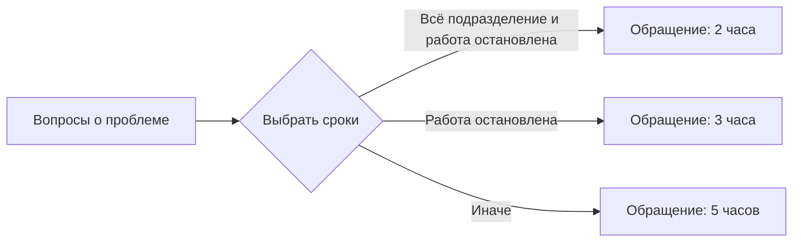

# Создание услуг и сценариев обращений с помощью JSON

Этот гайд предназначен для администратора Helpdesk и для подготовки сценариев
через ИИ. JSON описывает вопросы, инструкции, условия, направления обработки
и сроки. Сотрудник проходит опубликованный сценарий и затем отправляет обращение.
Создание услуги из JSON сохраняет черновик и не создаёт реальную заявку.

Действие **Создать услугу из JSON/YAML** относится к обновлённой Студии
([изменение интерфейса и API — PR #44](https://github.com/BorisDruzak/helpdesk/pull/44)).
Наличие этого действия зависит от установленной версии приложения. Если его нет,
используйте описанный ниже способ с экспортом существующей карты.

## 1. Выберите способ работы

| Задача | Действие в Студии | Внутренние идентификаторы в файле |
|---|---|---|
| Создать новую услугу | Каталог → **Создать услугу из JSON/YAML** | Можно опустить: сервер назначит новые привязки |
| Изменить существующую карту | Открыть карту → **JSON / YAML** → экспорт и импорт | Сохранить привязки именно этой карты |

Для новой услуги не нужно сначала создавать пустую карту и копировать её ключи.
Вы выбираете существующий раздел каталога и необязательную категорию в окне
импорта. Сервер создаёт новую услугу внутри выбранного раздела.

Раздел, категория, услуга и вход — разные вещи:

- **Раздел** — например, «Рабочее место».
- **Категория** — необязательная папка внутри раздела, например «Печать».
- **Услуга** — одна карта, например «Принтеры и МФУ».
- **Вход** — конкретная проблема в каталоге сотрудника, например «Застряла бумага».
  Одна карта может иметь несколько входов в разные её шаги.

## 2. Подготовьте ресурсы целевой среды

До генерации JSON определите действующие коды очередей и нужные сроки.
Публичное название очереди и её `queue_code` могут различаться. Возьмите код
из действующих настроек обработки или экспорта эталонной карты.

Примеры ниже содержат условные для переноса ссылки на очереди:

| Код в примере | Назначение |
|---|---|
| `servicedesk_l1` | Первая линия поддержки |
| `workplace_support` | Поддержка принтеров и рабочих мест |
| `network_support` | Сетевая поддержка |

**Перед импортом замените отсутствующие коды на существующие активные очереди
вашей среды.** Импорт не создаёт очереди и не подбирает им замену автоматически.

В настройках раздела каталога проверьте **Правила обработки новых услуг**.
Вариант «Как для …» выбирает существующий образец обработки. Если сервер
сообщает, что обработка раздела не настроена, задайте её и повторите проверку
документа. Внутренний ключ шаблона не нужно придумывать в JSON.

Правила закрытия, видимости, согласования и другие политики также должны быть
действующими. Они могут наследоваться от обработки раздела или выбираться
в **Обработке услуги** после создания черновика. Если готовность сообщает
об отсутствующем правиле, настройте соответствующее поле и сохраните карту.

## 3. Возьмите готовый JSON

| Пример | Что показывает |
|---|---|
| [Простой сценарий](examples/request-scenario-v3-minimal-portable.json) | Три блока: вопросы → условие → обращение; типизированное «Да/нет» и SLA 2/3/5 часов |
| [Полная карта принтеров](examples/request-scenario-v3-printer-portable.json) | 16 блоков, три входа, самопомощь, составные условия, три направления и три SLA |

На GitHub откройте нужный файл и используйте **Raw**, чтобы сохранить именно
JSON, а не HTML-страницу. Сохраните файл в UTF-8 с расширением `.json`.
Комментарии, завершающие запятые, повторяющиеся ключи и значения `NaN`/`Infinity`
не допускаются. Размер документа — не более 1 МиБ.

### Как устроен простой пример



В JSON все три ветви ведут к одному `submit_ticket`; отличаются назначенные
профили обработки. Ожидаемые результаты:

| Масштаб | Можно продолжать работу | Первый ответ | Решение |
|---|---|---|---|
| Всё подразделение | Нет | 30 минут | 120 минут |
| Только я | Нет | 60 минут | 180 минут |
| Любой | Да | 120 минут | 300 минут |

Это календарные минуты. Сам пример не назначает класс приоритета заявки:
он рассчитывается отдельными действующими серверными правилами.

## 4. Основные поля документа

Корень файла — один объект сценария. Не оборачивайте его в `data`, `definition`,
`nodes` или `edges` и не присылайте вместо него JSON Schema.

| Поле | Значение |
|---|---|
| `schema_version` | Для нового сценария используйте число `3` |
| `title` | Название услуги |
| `description` | Понятное описание помощи |
| `entry_block_id` | `id` начального блока карты |
| `entry_points` | Пункты каталога и их начальные блоки |
| `blocks` | Шаги и исходящие переходы |
| `processing` | Направления, профили SLA и значения по умолчанию |
| `editor_layout` | Необязательное расположение блоков на карте |
| `process_binding.policy_refs` | Необязательные явные ссылки на действующие политики |

При **создании новой услуги** можно не включать `scenario_key`, `service_code`,
`offering_full_code`, `category_id` и `process_binding.request_template_key`.
Выбранное в окне размещение определяет раздел и категорию, включая категории
всех входов. Идентификаторы из чужого экспорта не выбирают существующую карту:
новый импорт назначает собственные привязки.

Если нужен только набор `policy_refs`, допустима форма:

```json
{
  "process_binding": {
    "policy_refs": {
      "closure": "existing_closure_policy",
      "visibility": "existing_visibility_policy"
    }
  }
}
```

Это **фрагмент**, а не полный сценарий. Замените коды на реально существующие
правила или настройте их в интерфейсе. В v3 направления и SLA задаются внутри
`processing`: ссылки `policy_refs.routing` и `policy_refs.sla` не заменяют
собственные настройки карты.

Поле `publish_offering` не является командой немедленной публикации. Новая
услуга создаётся черновиком; доступность сотруднику появляется после отдельного
подтверждения публикации в Студии.

## 5. Блоки, вопросы и ссылки

| `kind` | Назначение | Основные настройки |
|---|---|---|
| `form_page` | Один или несколько вопросов | `fields`, `transitions` |
| `instruction` | Действия для сотрудника | `content`, `acknowledgment_required`, `transitions` |
| `resolution_check` | Помогла ли инструкция | Переходы по `current_result` |
| `decision` | Выбор пути по собранным ответам | Условия исходящих `transitions` |
| `submit_ticket` | Завершение с обращением | Название результата |
| `finish` | Завершение без обращения | Название и сообщение |

Это рабочий набор для новых карт. Не добавляйте выдуманные виды вроде
`question`, `yes_no`, `start` или `ticket`. В визуальном редакторе они могут
называться иначе: вопрос «Да/нет» хранится как поле типа `checkbox` внутри
`form_page`. «Начало» задаётся входами карты, а не отдельным блоком `start`.

У блока есть уникальный `id`, у вопроса — `key`. Используйте латинские
строчные буквы, цифры и `_`, например `q_scope` и `printer_connection`.
Названия, подписи и инструкции пишите по-русски.

- `entry_block_id`, `entry_points[].target_block_id` и `transitions[].to`
  ссылаются на `blocks[].id`.
- `when.field` ссылается на `fields[].key`, а не на русскую подпись вопроса.
- Вариант ответа хранит техническое `value` и видимое сотруднику `label`.
  Условие сравнивает именно `value`.
- Вопрос, на ответ которого ссылается условие, должен быть пройден до этого
  условия. Нельзя рассчитывать на ответ из другой, непройденной ветви.
- У каждого маршрута должно быть корректное завершение. Не делайте циклы,
  ссылки на отсутствующие шаги и зависшие ветви.

## 6. Условия: «Да», «Нет», AND, OR и «Иначе»

### Обычный вопрос «Да/нет»

В простом примере `can_continue` — поле `checkbox`. Условие для ответа «Нет»:

```json
{
  "source": "answer",
  "field": "can_continue",
  "op": "eq",
  "value": false
}
```

`false` и `true` — логические значения JSON, без кавычек. Строка `"false"`
не равна `false`. Неизвестный или отсутствующий ответ также не равен ответу «Нет».
Оператор `exists` означает «ответ задан», а не «ответ Да».

### Составное условие

В срочной ветви простого примера оба условия должны выполниться:

```json
{
  "op": "and",
  "conditions": [
    {"source": "answer", "field": "scope", "op": "eq", "value": "department"},
    {"source": "answer", "field": "can_continue", "op": "eq", "value": false}
  ]
}
```

`and` требует все вложенные условия, `or` — хотя бы одно. Группы можно
вкладывать друг в друга. Для `and`/`or` используется массив `conditions`,
для `not` — одно поле `condition`. Пример содержательного вложенного `or`
есть в полной карте принтеров: **сетевой принтер И (работа остановлена ИЛИ
затронуто всё подразделение)**.

### Приоритет ветвей

Условные переходы в примерах имеют `priority: 10`, `20` и далее.
Меньшее число проверяется раньше. Это важно, когда несколько условий подходят:
остановка работы всего отдела подходит и под срочную, и под повышенную ветвь;
срочная должна иметь преимущество.

На одном шаге выбирается подходящий переход. `transition.priority` задаёт
порядок ветвей и не является классом приоритета заявки P1/P2/P3.
В конце `decision.transitions` оставьте один переход без `when` — **«Иначе»**.
Он нужен и при наличии отдельных условий для `true` и `false`.

### Проверка результата инструкции

У `resolution_check` результат передаётся через `current_result`:
строки `"yes"`, `"no"`, `"unknown"`. Например:

```json
{
  "to": "resolved",
  "priority": 10,
  "when": {"source": "current_result", "op": "eq", "value": "yes"}
}
```

В полной карте положительный результат ведёт к `finish`, а «Нет»/«Не знаю» —
к вопросам поддержки. Не заменяйте подтверждённую проверку результата прямым
переходом из произвольного вопроса в `finish`. Текст инструкции должен
соответствовать реальным связям: если он обещает прямую отправку обращения,
такой переход действительно должен существовать.

## 7. Направления, SLA и приоритет заявки

`processing.routes` и `processing.sla_profiles` — словари с вашими логическими
ключами, а не массивы. Ключи `support`, `urgent` и другие используются
в `defaults` и в назначениях перехода:

```json
{
  "processing": {"route": "support", "sla_profile": "urgent"}
}
```

Это фрагмент **перехода**. Профиль `urgent` и направление `support` должны
существовать в соответствующих словарях карты.

`assignment_mode: "last_matching_branch"` означает: последнее явное назначение
в **пройденном маршруте** заменяет предыдущее. Очередь и SLA назначаются
независимо. Если на ветви ничего не назначено, сохраняется предыдущее значение
или настройка по умолчанию. Это не команда выполнять все подходящие стрелки
одного блока.

Для готового сценария задавайте положительные целые минуты первого ответа
и решения. В примерах 120/180/300 минут означают 2/3/5 часов календарного времени.
Для рабочего времени нужны `time_basis: "business"` и действующий `calendar_id`
из вашей среды; произвольное число не создаст календарь.

Класс приоритета заявки рассчитывает сервер по действующим правилам. Если
ответы должны влиять на масштаб, срочность или важность, используйте
`process_mapping` и допустимые типизированные факты, как в полной карте принтеров.
Назначение профиля `urgent` само по себе не устанавливает P1, а P1 само по себе
не задаёт срок в два часа.

## 8. Создайте услугу из файла

1. Откройте **Студию обращений → Каталог** (`/app/admin/request-template-studio`).
2. Нажмите **Создать услугу из JSON/YAML**.
3. Выберите существующий раздел и при необходимости категорию.
4. Загрузите `.json` или вставьте текст. Выберите формат **JSON**.
5. Нажмите **Проверить документ**. Проверьте название, число шагов и входов,
   а также все сообщения с путями к ошибкам.
6. Исправьте документ или недостающие настройки и проверьте его снова.
7. Когда ошибок нет, нажмите **Создать услугу-черновик**.
8. Убедитесь, что открылась нужная карта и показано **Черновик сохранён**.

Предварительная проверка не создаёт услугу. Изменение текста, формата, раздела
или категории отменяет предыдущий результат проверки. При изменении обработки
раздела между проверкой и созданием понадобится новая проверка.

При временном сбое создания текст остаётся в окне. Повторное нажатие в том же
окне использует тот же ключ операции и не создаёт дубль. Не открывайте новое
окно для повторного создания вслепую: сначала проверьте, появилась ли услуга
в каталоге. Новый независимый импорт предназначен для новой услуги.

## 9. Проверьте карту до публикации

Откройте **Тестировать**. Ответы обрабатывает сервер; реальные обращения,
согласования и операции устройства в этой проверке не создаются.

Для простого примера проверьте все строки таблицы из раздела 3.
Для полной карты выберите по очереди все три входа и проверьте как минимум:

| Набор ответов | Ожидаемая обработка |
|---|---|
| После инструкции «Да, решено» | Завершение без обращения |
| Только я; можно продолжать; USB | Первая линия, 120/300 минут |
| Только я; работа остановлена; сеть | Сетевая поддержка, 60/180 минут |
| Всё подразделение; работа остановлена; сеть | Сетевая поддержка, 30/120 минут |
| Всё подразделение; работа остановлена; USB | Поддержка принтеров, 30/120 минут |
| Всё подразделение; работа остановлена; подключение неизвестно | Первая линия, 30/120 минут |

Сверяйте не только название результата, но и фактическую очередь, первый ответ,
срок решения и объяснение **Почему выбран этот результат**. Проверьте также
«Не знаю», обязательные ответы и все резервные переходы.

## 10. Опубликуйте и проверьте кабинет сотрудника

1. Сохраните карту.
2. Нажмите **Опубликовать → Подготовить публикацию**.
3. Дождитесь окончания серверной проверки всех допустимых исходов.
4. Устраните препятствия: отсутствующие очереди, календари, правила закрытия,
   видимости или другие ошибки, указанные сервером.
5. Просмотрите изменения, отметьте **Изменения проверены, подтверждаю публикацию**
   и нажмите **Опубликовать сценарий**.
6. Дождитесь сообщения **Опубликована версия …**.
7. Используйте **Открыть сценарий сотрудника** и проверьте нужный пункт каталога.

В обновлённом интерфейсе во время запросов видны **Проверяем публикацию…** и
**Публикуем сценарий…**. Кнопки временно недоступны. Это состояние ожидания;
не отправляйте новую публикацию из другой вкладки. При неопределённом результате
сначала проверьте статус услуги и **Версии → История версий**.

**Сохранённый черновик не участвует в поиске сотрудника.** Публичный каталог
использует действующую опубликованную версию, её доступные входы и размещение.
Поиск учитывает названия, описания и `synonyms` входов. Внутренние ключи и тексты
вопросов не заменяют поисковые названия входов.

Неполный профиль — отдельная причина отсутствия формы: обычные формы могут
требовать заполнения профиля. Также действуют настройки доступности формы,
раздела, категории и устройства. Публикация карты не отменяет эти требования.
Если публикация прошла, но поиск пуст, проверьте их до изменения текста запроса.

## 11. Как обновить существующую карту

1. Откройте нужную карту и сохраните текущие изменения.
2. Раскройте **JSON / YAML** под картой, выберите JSON и **Скачать карту**.
3. Редактируйте этот экспорт. Сохраните `scenario_key`, `service_code`,
   `offering_full_code` и `process_binding.request_template_key` данной карты.
4. Загрузите изменённый файл в ту же панель, нажмите **Проверить импорт**.
5. Примените проверенный документ к локальному черновику и сохраните его.
6. Повторите тестирование и отдельную подтверждённую публикацию.

Переносимый пример без внутренних привязок предназначен для **новой** услуги.
Для обновления используйте экспорт целевой карты. Ошибка
`CATALOG_BINDING_IMMUTABLE` означает, что импорт пытается заменить её привязку;
не обходите проверку подстановкой идентификаторов другой услуги.

## 12. Типичные ошибки

| Сообщение или симптом | Что проверить |
|---|---|
| Не настроена обработка раздела | Настройки раздела → **Правила обработки новых услуг** |
| `processing.routes.<ключ>.queue_code` | Существует ли очередь с таким кодом и активна ли она |
| Ошибка календаря | `time_basis`, реальный `calendar_id` и настройки рабочего календаря |
| Ошибка `process_binding.policy_refs` | Существование, активность и публикацию выбранного правила |
| Условие не срабатывает | `field` совпадает с ключом вопроса; `value` имеет правильный тип; вопрос уже пройден |
| Нет пути при «Не знаю» | Последний безусловный переход и фактические ответы на этом входе |
| Неизвестный блок или вопрос | Значения `to`, `entry_block_id`, `target_block_id` и `field` |
| Проверка требует сократить карту | Число допустимых комбинаций ответов; разбейте слишком сложный процесс |
| JSON принят, но кнопки создания нет | Исправлены ли все ошибки предпросмотра; не изменился ли документ после проверки |
| Импорт создан, но поиск ничего не находит | Публикацию, доступность входов/размещения, профиль и правила доступности формы |
| Кнопки публикации временно отключены | Видимый статус запроса; затем итог, статус услуги и историю версий |

Неизвестные поля строгий контракт отвергает. JSON может пройти синтаксическую
проверку и всё равно содержать ошибку графа, ссылки на ресурс или обработки.

## 13. Задание для ИИ

Передайте ИИ этот гайд, один полный пример и реальные коды ресурсов вашей среды.
Можно использовать следующий запрос, заполнив квадратные скобки:

```text
Подготовь один валидный JSON сценария Helpdesk Guided Request Studio v3.
Результат нужен для действия «Создать услугу из JSON/YAML».

Услуга: [название и описание].
Входы каталога: [названия, описания, синонимы, начальные шаги].
Вопросы и допустимые ответы: [перечень].
Инструкции и проверка результата: [что можно проверить и как продолжать].
Правила ветвления: [условия и резервные пути].
Действующие queue_code: [коды и назначение].
Профили SLA: [первый ответ, решение, календарное/рабочее время].
Действующие календари/политики: [только известные коды и ID или «выберу в UI»].

Опирайся на приложенный переносимый пример и контракт v3.
Не включай внутренние scenario_key, service_code, offering_full_code,
category_id и process_binding.request_template_key: назначение выберу в UI.
Не выдумывай queue_code, policy_refs и calendar_id. Если для обязательной
логики не хватает данных, перечисли вопросы до генерации готового файла.
У каждого блока должен быть уникальный id, у вопроса — key;
все ссылки должны существовать. Условия ссылаются на уже собранные ответы.
Для checkbox используй boolean true/false; для resolution_check —
current_result со строками yes/no/unknown. Не смешивай эти типы.
Составные условия оформляй через and/or с conditions.
Задай явный порядок пересекающихся ветвей и один резервный переход decision.
Разделяй порядок переходов, класс приоритета заявки, очередь и профиль SLA.
После инструкции предусмотри положительное завершение только через
проверку результата, а отрицательный/неизвестный результат веди к поддержке.
Текст каждого шага должен соответствовать его фактическим переходам.
Не добавляй исполняемые команды, неизвестные поля или JSON-обёртки.
Верни полный JSON без комментариев и отдельно таблицу контрольных проходов.
```

Перед импортом проверьте результат ИИ самостоятельно. Технический контракт:
[JSON Schema](contracts/request-scenario.schema.json). Он описывает
**нормализованную карту**, включая внутренние привязки; новый переносимый импорт
добавляет их до проверки этого контракта. Для проверки переносимого файла
используйте **Проверить документ**, для полного экспорта — **Проверить импорт**.

Дополнительно: [руководство администратора](UNIFIED_SERVICE_SCENARIOS.md) и
[контракты и устройство сценариев](../server/docs/GUIDED_REQUEST_SCENARIOS.md).
